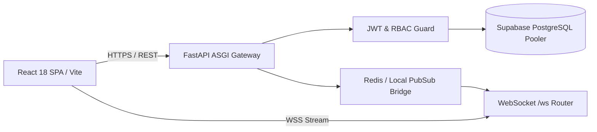

# Connect Teams — Enterprise Collaboration Platform

> Real-time multi-workspace team messaging, channel orchestration, and role-based access control (RBAC) for distributed engineering organizations.

[](https://github.com/rajkelangork-alt/connect-teams/actions)


**Live demo:** [connect-teams-ashen.vercel.app](https://connect-teams-ashen.vercel.app)
**API docs:** [connect-teams-api.onrender.com/docs](https://connect-teams-api.onrender.com/docs)

---

## Demo Logins

| Role            | Email                    | Password       | Access                                                                                     |
| :-------------- | :----------------------- | :------------- | :----------------------------------------------------------------------------------------- |
| System Admin    | `admin@connectteams.com` | `Admin@12345`  | Full workspace creation, channel management, user provisioning, and RBAC badge assignment |
| Workspace Admin | `lead@connectteams.com`  | `Lead@12345`   | Channel administration, member moderation, and workspace settings (capped at 2 holders)    |
| Team Member     | `alex@connectteams.com`  | `Member@12345` | Real-time channel messaging, direct messages (DMs), file sharing, and presence indicators  |

---

## 1. Problem & Solution

- **Problem:** Distributed engineering teams often rely on fragmented communication tools that lack strict corporate domain boundaries, predictable role hierarchies, or lightweight self-hostable architectures without expensive per-seat enterprise licensing.
- **Solution:** A full-stack, real-time collaboration platform bounded by `@connectteams.com` corporate isolation, featuring multi-workspace channel streams, direct messaging, WebSocket pub/sub synchronization with automatic local fallback, and tiered role-based access control.
- **Outcome:** Near-instant message delivery over persistent WebSockets, non-blocking database persistence via asynchronous SQLAlchemy connection pooling, and strict permission enforcement across workspaces and channels.

---

## 2. Key Features

- **Corporate domain & capacity guardrails:** Enforces `@connectteams.com` email isolation with structured organizational capacity (1 System Admin, up to 7 Member accounts, and a maximum of 2 Workspace Admin badge holders).
- **Real-time WebSocket messaging & resilient pub/sub:** Bi-directional WebSocket streams broadcast channel messages, direct messages, typing indicators, and live online presence, with automatic fallback from Redis Pub/Sub to local in-memory mode.
- **Multi-workspace & channel orchestration:** Switch between isolated workspaces (e.g., *Acme Engineering*, *Product Architecture*) and topic-specific channels (`#general`, `#be-dev-group`, `#fe-dev`, `#dev-ops`).
- **Granular RBAC & permission guards:** FastAPI dependency injection (`Depends(get_current_user)`) protects routes, restricts administrative mutations, and enforces workspace-level membership checks.
- **Rich media & static file serving:** Built-in upload handling and static asset mounting (`/uploads`) for sharing attachments and image previews inside conversation threads.

---

## 3. Architecture



### Key Design Decisions

| Decision        | Choice                                   | Why                                                                | Alternative          |
| :-------------- | :--------------------------------------- | :----------------------------------------------------------------- | :------------------- |
| Real-time sync  | WebSockets + Redis/Local PubSub fallback | Zero-downtime boots even without an external Redis node            | Polling, Firebase    |
| Database driver | PostgreSQL + asyncpg (SQLAlchemy 2.0)    | Non-blocking async I/O under concurrent chat loads                 | Synchronous psycopg2 |
| Authentication  | Stateless JWT (HS256) + OAuth2 Bearer    | Scales cleanly across decoupled frontend/backend hosts             | Server-side sessions |
| Monorepo layout | Isolated `be/` and `fe/` directories     | Independent build pipelines on Render and Vercel                   | Single coupled repo  |

---

## 4. Tech Stack

| Layer           | Technology                                                                                       |
| :-------------- | :----------------------------------------------------------------------------------------------- |
| Backend         | Python 3.12+, FastAPI, Uvicorn, Gunicorn, SQLAlchemy 2.0 (asyncio), Pydantic v2, Alembic         |
| Data & Caching  | PostgreSQL (Supabase IPv4 Session Pooler), asyncpg, Redis (with in-memory fallback)              |
| Frontend        | React 18, Vite, TypeScript & JavaScript, Tailwind CSS, Lucide React                              |
| DevOps & Cloud  | GitHub Actions, Vercel (frontend edge network), Render (FastAPI web service), Docker             |
| Quality Tooling | Pytest, pytest-asyncio, HTTPX AsyncClient, Mypy, Prettier                                        |

---

## 5. Project Structure

```
.
├── .github/workflows/          # GitHub Actions CI pipeline
│   └── ci.yml
├── be/                         # FastAPI backend application
│   ├── alembic/                # Database schema migrations
│   ├── app/
│   │   ├── api/                # Versioned REST routers (/api/v1)
│   │   ├── core/               # Config, JWT security, constants, dependencies, exceptions
│   │   ├── db/                 # Async SQLAlchemy engine & session factories
│   │   ├── middleware/         # Request logging and access middleware
│   │   ├── models/             # ORM models (User, Workspace, Channel, Message)
│   │   ├── services/           # Business logic and workspace permission services
│   │   ├── utils/              # Helper utilities and formatters
│   │   ├── workers/            # Background tasks and pub/sub listeners
│   │   ├── ws/                 # WebSocket routers, connection managers, Redis bridge
│   │   ├── main.py             # FastAPI app initialization, CORS, static mounts
│   │   └── settings.py         # Application environment settings
│   ├── tests/                  # Pytest async test suites
│   ├── uploads/                # User-uploaded static files & image previews
│   ├── .env.example            # Backend environment template
│   ├── Dockerfile              # Container build configuration
│   └── requirements.txt        # Production Python dependencies
├── fe/                         # React + Vite frontend application
│   ├── public/                 # Static public assets
│   ├── src/                    # Components, contexts, hooks, and API client services
│   ├── .env.example            # Frontend environment template
│   ├── index.html              # SPA entry HTML
│   └── vercel.json             # Vercel SPA routing rewrites
├── docker/                     # Docker auxiliary configurations
├── docs/                       # Architectural & API documentation
├── .gitignore
└── README.md
```

---

## 6. API Overview

| Method | Endpoint                                     | Description                                                     | Auth             |
| :----- | :------------------------------------------- | :-------------------------------------------------------------- | :--------------- |
| POST   | `/api/v1/auth/login`                         | Authenticate a `@connectteams.com` user and issue an HS256 JWT  | Public           |
| GET    | `/api/v1/workspaces`                         | List workspaces accessible to the authenticated member          | Authenticated    |
| POST   | `/api/v1/workspaces`                         | Create a new engineering workspace and seed default channels    | System Admin     |
| GET    | `/api/v1/workspaces/{workspace_id}/channels` | Fetch public and private channels within a workspace            | Workspace Member |
| POST   | `/api/v1/workspaces/{workspace_id}/channels` | Provision a new topic channel inside a workspace                | Workspace Admin  |
| GET    | `/api/v1/channels/{channel_id}/messages`     | Retrieve paginated message history (`?limit=50&before_id=...`)  | Workspace Member |
| POST   | `/api/v1/channels/{channel_id}/messages`     | Persist a new message to PostgreSQL and broadcast via WebSocket | Workspace Member |
| DELETE | `/api/v1/messages/{message_id}`              | Soft or hard delete a message by ID (`204 No Content`)          | Author / Admin   |
| WS     | `/ws`                                        | Real-time bi-directional messaging, typing, and presence stream | JWT Scoped       |

---

## 7. Getting Started

**Prerequisites:** Python 3.12+, Node.js 18+ and npm, and a PostgreSQL database (Supabase project).

### Backend (`be`)

```bash
cd be
python -m venv .venv

# Windows (PowerShell)
.\.venv\Scripts\Activate.ps1
# macOS / Linux
source .venv/bin/activate

pip install -r requirements.txt
cp .env.example .env

# Set DATABASE_URL (postgresql+asyncpg://...) and JWT_SECRET_KEY in .env
uvicorn app.main:app --reload --port 8000
```

### Frontend (`fe`)

```bash
cd fe
cp .env.example .env     # set VITE_API_URL=http://localhost:8000/api/v1
npm install
npm run dev
```

---

## 8. Testing & Quality

```bash
cd be
pytest tests/ -v
```

---

## 9. Security

- **Password hashing:** Salted bcrypt password hashes via passlib. Plain-text credentials are never stored or logged.
- **Strict CORS policy:** Scoped to trusted origins (`https://connect-teams-ashen.vercel.app`) and local development ports.
- **Schema validation & sanitization:** Pydantic v2 models validate incoming payloads and strip password hashes from serialized API responses.
- **Repository hygiene:** `.gitignore` rules exclude all `.env` files across `be/` and `fe/`, while tracking clean `.env.example` templates.

---

## 10. Performance & Scalability

- **Asynchronous ORM pipeline:** SQLAlchemy 2.0 `AsyncSession` paired with asyncpg and Supabase IPv4 connection pooling avoids thread blocking during concurrent chat spikes.
- **Graceful pub/sub degradation:** Detects Redis availability on startup and falls back to an in-memory event bridge (local mode), so single-instance cloud deployments run without an external cache.
- **Lightweight frontend bundle:** Vite ESBuild bundling with tree-shakable `lucide-react` icons and atomic Tailwind CSS utilities.

---

## 11. Deployment

- **Frontend:** Hosted on Vercel ([connect-teams-ashen.vercel.app](https://connect-teams-ashen.vercel.app)) with `fe` root directory isolation, automatic Vite builds, and `vercel.json` SPA routing rewrites.
- **Backend:** Hosted on Render ([connect-teams-api.onrender.com](https://connect-teams-api.onrender.com)) as a containerized Python web service running `uvicorn app.main:app --host 0.0.0.0 --port $PORT`.
- **Database:** Hosted on Supabase PostgreSQL using the `aws-0-ap-northeast-1` IPv4 connection pooler over port 5432.
- **CI/CD:** Automated backend and frontend builds via GitHub Actions (`.github/workflows/ci.yml`).

---

## 12. What I Learned / Trade-offs

- **Async driver URI strictness:** Deploying SQLAlchemy's async engine to Render required enforcing the `postgresql+asyncpg://` protocol prefix and URL-encoding special password characters when rotating Supabase pooler credentials.
- **Redis vs. in-memory fallback:** On free-tier cloud hosting without a managed Redis instance, a resilient pub/sub bridge lets the FastAPI server log a non-fatal warning and fall back to local memory without crashing the worker process.
- **Ephemeral filesystem uploads:** User uploads currently mount to Render's local `/uploads` directory. In a multi-instance production cluster, I would move file attachments to an S3-compatible object store (such as Supabase Storage or AWS S3).

---

## 13. Author

**Full Stack Developer** | Python/FastAPI, React/Next.js, TypeScript

GitHub: [@rajkelangork-alt](https://github.com/rajkelangork-alt) | Live platform: [connect-teams-ashen.vercel.app](https://connect-teams-ashen.vercel.app)

Available for freelance projects.

---

## License

This project is licensed under the MIT License.